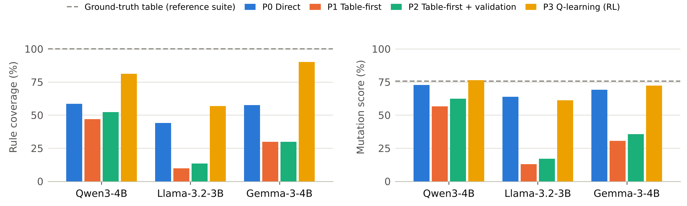
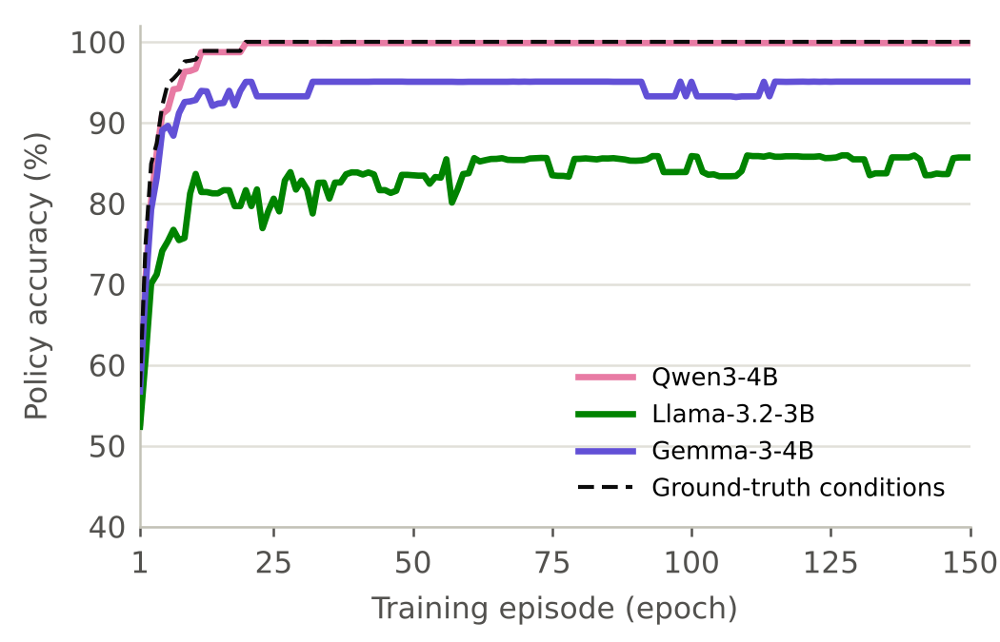

# DTBench: LLM-based generation and validation of decision-table test cases

Benchmark, code and results for the term paper *LLM-Based Generation and Validation of Decision Table Test
Cases* (Software Testing and Quality Assurance, B.Tech. CSE, Nirma University, 2026).

**Dataset:** [`data/DTBench`](data/DTBench) contains 12 business-rule specifications with ground-truth
decision tables (111 feasible rules), independent reference implementations and 77,818 evaluation probes.
See [`data/DTBench/README.md`](data/DTBench/README.md) for the format, sources and licence.


The pipeline asks a large language model (LLM) to turn natural-language business rules into a
decision table, checks that table automatically, feeds the problems back for repair, derives one
test case per rule, and scores everything against a verified ground truth. A reinforcement-learning
strategy (P3) keeps the LLM's conditions and learns the table's outputs with tabular Q-learning in a
Gymnasium environment: the Q-table becomes the decision table.

## Strategies

| Strategy | Model calls per spec | Test cases come from |
|---|---|---|
| P0 Direct | 1 | written by the LLM |
| P1 Table-first | 1 | derived from the LLM's decision table (one per rule) |
| P2 Table-first + validation | 1 + up to 2 repairs | derived from the repaired table |
| P3 Q-learning (RL) | 0 (uses the P2 conditions) | derived from the Q-table learned on the system's outputs (one per state) |
| REF | 0 | derived from the ground-truth table with the same procedure |

**P3 environment** (`dtbench/rl/env.py`, registered as `dtbench/DecisionTable-v0`): the state is the
combination of the table's conditions that a test input falls in, the action is an output value, and the
reward is +1 when the system under test (the reference implementation) returns that output, otherwise -1.
One episode visits every combination once (one epoch). The agent (`dtbench/rl/qlearning.py`) is tabular
Q-learning with epsilon-greedy exploration; its settings are in [`config/rl_config.json`](config/rl_config.json).

## Results at a glance

Three open-weight models (4-bit GGUF, run locally on CPUs with llama.cpp), 12 specifications, greedy decoding.
Rule coverage = share of the 111 ground-truth rules exercised by at least one test whose expected output is
correct; mutation score over 324 non-equivalent mutants of the reference implementations; table accuracy =
share of evaluation probes on which the table gives the right output.

| Model | Strategy | Tests | Oracle acc. | Rule coverage | Missed rules (of 111) | Mutation score | Table acc. |
|---|---|---:|---:|---:|---:|---:|---:|
| Qwen3-4B | P0 Direct | 215 | 69.6% | 58.6% | 46 | 72.8% |  |
| Qwen3-4B | P1 Table-first | 68 | 87.6% | 46.8% | 59 | 56.5% | 59.2% |
| Qwen3-4B | P2 Table-first + validation | 108 | 80.3% | 52.3% | 53 | 62.3% | 72.9% |
| Qwen3-4B | P3 Q-learning (RL) | 241 | 100.0% | 81.1% | 21 | 76.2% | 99.9% |
| Llama-3.2-3B | P0 Direct | 367 | 62.1% | 44.1% | 62 | 63.9% |  |
| Llama-3.2-3B | P1 Table-first | 26 | 41.7% | 9.9% | 100 | 13.0% | 12.3% |
| Llama-3.2-3B | P2 Table-first + validation | 95 | 43.2% | 13.5% | 96 | 17.0% | 15.6% |
| Llama-3.2-3B | P3 Q-learning (RL) | 167 | 91.4% | 56.8% | 48 | 61.1% | 80.4% |
| Gemma-3-4B | P0 Direct | 301 | 61.2% | 57.7% | 47 | 69.1% |  |
| Gemma-3-4B | P1 Table-first | 65 | 60.7% | 29.7% | 78 | 30.6% | 39.4% |
| Gemma-3-4B | P2 Table-first + validation | 79 | 63.8% | 29.7% | 78 | 35.5% | 36.3% |
| Gemma-3-4B | P3 Q-learning (RL) | 298 | 94.7% | 90.1% | 11 | 72.2% | 94.4% |
| Ground-truth conditions | P3 Q-learning (RL) | 284 | 100.0% | 100.0% | 0 | 76.9% | 100.0% |
| Ground truth | REF (ground-truth table) | 111 | 100.0% | 100.0% | 0 | 75.6% |  |

Paired Wilcoxon signed-rank tests over the 36 (model, specification) pairs (`results/stats.json`):

* P1 vs P0: lower rule coverage (worse in 24, better in 3; p < 0.001) and lower mutation score (worse in 28,
  better in 4; p < 0.001). These small models write better test suites directly than through their own tables.
* P2 vs P1: higher table accuracy (better in 18, worse in 5; p = 0.035) and more ground-truth rules handled
  correctly (better in 12, worse in 2; p = 0.044); the gains in rule coverage and mutation score are not
  significant (p = 0.12 for both).
* P3 vs P2: higher table accuracy (better in 31 of 34, never worse; +50.2 points; p < 0.001), rule coverage
  (better in 31, never worse; +42.0 points; p < 0.001) and mutation score (better in 29, never worse; p < 0.001).
  P3 vs P0: higher rule coverage (+22.4 points, p < 0.001), same mutation score (p = 0.61).
* P3 learns from the system's outputs, which the LLM strategies never see; its remaining errors come from LLM
  conditions that do not separate the cases (for example Gemma-3-4B's BMI table never tests the BMI).





## Layout

```
config/
  llm_config.json   temperature, seed, max tokens, repair rounds (read by dtbench/runner.py)
  rl_config.json    episodes (epochs), alpha, gamma, epsilon schedule, rewards, seed (read by dtbench/rl/run.py)
dtbench/
  specs.py          12 benchmark specifications with ground-truth decision tables
  reference/        independent reference implementation for every specification (test oracle)
  expr.py           safe parsing/evaluation of condition expressions (Python ast whitelist)
  model.py          data dictionary: input types, domains, value coercion, output normalisation
  table.py          executable limited-entry decision tables (unique-hit semantics)       Algorithm 1
  probes.py         predicate-guided probe synthesis                                       Algorithm 2
  validator.py      ground-truth-free structural check + evaluation against ground truth   Algorithm 2
  runner.py         LLM calls for strategies P0 / P1 / P2 (repair loop)                    Algorithm 3
  derive.py         mechanical test derivation, one test per rule                          Algorithm 3
  rl/env.py         Gymnasium environment: state = condition combination, action = output, reward +/-1
  rl/qlearning.py   tabular Q-learning agent, Q-table export, learned decision table       Algorithm 4
  rl/run.py         trains P3 for every model and specification
  test_eval.py      validity, oracle accuracy, rule coverage, missed rules, mutation score
  mutation.py       first-order mutants (ROR, LCR, AOR, CRP, RVR, NEG, NDL), equivalence by probing
  prompts.py        prompt templates and JSON schemas
  grammars/         the same output formats as GBNF grammars (for release builds of llama.cpp)
  llm.py            client for OpenAI-compatible endpoints (llama.cpp server, Groq, OpenAI, ...)
  analysis.py       all metrics from the cached LLM outputs and the learned Q-tables
scripts/
  verify_benchmark.py      checks every ground-truth table against its reference code
  export_dataset.py        writes the dataset package (data/DTBench)
  run_model.sh             Linux: starts llama-server for one model and runs all specifications
  run_models_windows.ps1   Windows: downloads llama.cpp and the models, runs all specifications
  schema2gbnf.cpp          converts the JSON schemas to the GBNF grammars in dtbench/grammars
  make_results.py          aggregates metrics, Wilcoxon tests, LaTeX tables, figures
  make_diagram.py          architecture diagram
  make_notebook.py         builds the walkthrough notebook
notebooks/DTBench_Experiment.ipynb   walkthrough that reproduces every result (incl. a Q-learning run)
results/raw/<model>/<spec>/*.json   every prompt and raw model response (cached)
results/rl/<model>/<spec>/          q_table.csv, learned_table.json, curve.csv (per episode), summary.json
results/*.csv|json                   metrics per run, summary, statistics
figures/, tables/                    figures (PDF/PNG) and LaTeX tables used in the paper
docs/DTBench_Algorithms.pdf          the four algorithms and the metric definitions
```

## Reproduce the results (no LLM needed)

All model responses are saved in `results/raw`, so the analysis is deterministic:

```
pip install -r requirements.txt
python scripts/verify_benchmark.py      # ground truth vs reference code: expect "ALL OK"
python -m dtbench.rl.run                # Q-learning (P3) for every model and specification, a few seconds
python scripts/make_results.py          # metrics, statistics, tables, figures
```

Or open `notebooks/DTBench_Experiment.ipynb` and run all cells.

## Re-run the LLM experiment

Models (Q4_K_M GGUF files from Hugging Face): `unsloth/Qwen3-4B-Instruct-2507-GGUF`,
`bartowski/Llama-3.2-3B-Instruct-GGUF`, `bartowski/google_gemma-3-4b-it-GGUF`. Settings
(`config/llm_config.json`): temperature 0, seed 42, at most 2500 generated tokens, at most 2 repair rounds;
context 6144 tokens (8192 in the first Qwen3-4B session; the longest call used 5,001 tokens), one server slot,
no prompt cache (`--cache-ram 0`), constrained JSON output with types and allowed values enforced but numeric
ranges not enforced. The models are used as they are: there is no training and therefore no epochs for the LLMs.

The paper's run used two CPU-only machines: Qwen3-4B on a 2-vCPU cloud container (llama.cpp built from source,
with the whitespace rule in `common/json-schema-to-grammar.cpp` set to `SPACE_RULE = "\" \"?"` so that the
schema-derived grammar produces compact JSON), and Llama-3.2-3B and Gemma-3-4B on an 8-core laptop (official
Windows release b11635, with the equivalent grammars from `dtbench/grammars` sent with every request).

```
# Windows, from a clone of this repository (downloads everything it needs)
powershell -ExecutionPolicy Bypass -File scripts\run_models_windows.ps1

# Linux / WSL, after building llama-server and downloading the models
LLAMA_SERVER=/path/to/llama-server MODELS_DIR=/path/to/models scripts/run_model.sh qwen3-4b
scripts/run_model.sh llama3.2-3b
scripts/run_model.sh gemma3-4b
python -m dtbench.rl.run
python scripts/make_results.py
```

With an unmodified llama.cpp build on Linux, add `--grammar-dir dtbench/grammars` to the `dtbench.runner`
call in `run_model.sh`. Any OpenAI-compatible endpoint also works (for example a hosted model with an API key):

```
LLM_API_KEY=... python -m dtbench.runner --model my-model --base-url https://api.provider.com/v1 --api-model <name>
```

Delete `results/raw/<model>` first if you want fresh responses; existing files are reused.

## Licence

Code: MIT (see `LICENSE`). Dataset: see `data/DTBench/README.md`.
