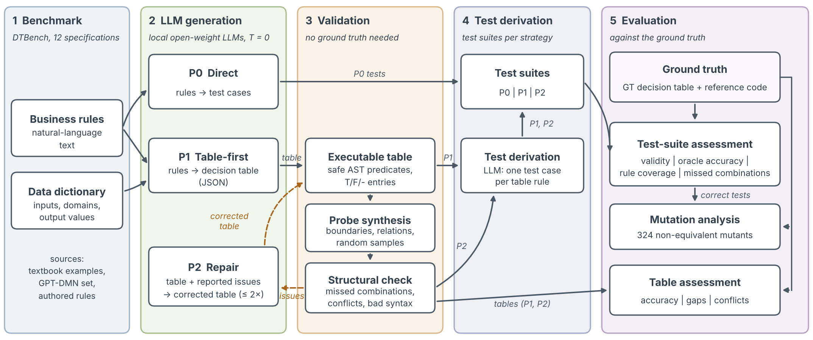

# DTBench: LLM-based generation and validation of decision-table test cases

Benchmark, code and results for the term paper *LLM-Based Generation and Validation of Decision Table Test
Cases* (Software Testing and Quality Assurance, B.Tech. CSE, Nirma University, 2026).

**Dataset:** [`data/DTBench`](data/DTBench) contains 12 business-rule specifications with ground-truth
decision tables (111 feasible rules), independent reference implementations and 77,818 evaluation probes.
See [`data/DTBench/README.md`](data/DTBench/README.md) for the format, sources and licence.



The pipeline asks a large language model (LLM) to turn natural-language business rules into a
decision table, checks that table automatically, feeds the problems back for repair, derives one
test case per rule, and scores everything against a verified ground truth.

## Layout

```
dtbench/
  specs.py          12 benchmark specifications with ground-truth decision tables
  reference/        independent reference implementation for every specification (test oracle)
  expr.py           safe parsing/evaluation of condition expressions (Python ast whitelist)
  model.py          data dictionary: input types, domains, value coercion, output normalisation
  table.py          executable limited-entry decision tables (unique-hit semantics)       Algorithm 1
  probes.py         predicate-guided probe synthesis                                       Algorithm 2
  validator.py      ground-truth-free structural check + evaluation against ground truth   Algorithm 2
  runner.py         LLM calls for strategies P0 / P1 / P2 (repair loop)                    Algorithm 3
  derive.py         mechanical test derivation, one test per rule                          Algorithm 3
  test_eval.py      validity, oracle accuracy, rule coverage, missed rules, mutation score
  mutation.py       first-order mutants (ROR, LCR, AOR, CRP, RVR, NEG, NDL), equivalence by probing
  prompts.py        prompt templates and JSON schemas
  llm.py            client for OpenAI-compatible endpoints (llama.cpp server, Groq, OpenAI, ...)
  analysis.py       all metrics from the cached LLM outputs
scripts/
  verify_benchmark.py   checks every ground-truth table against its reference code
  export_dataset.py     writes the dataset package (data/DTBench)
  run_model.sh          starts llama-server for one model and runs all specifications
  make_results.py       aggregates metrics, Wilcoxon tests, LaTeX tables, figures
  make_diagram.py       architecture diagram
  make_paper.py         Overleaf project with figures, tables, algorithms and writing notes
notebooks/DTBench_Experiment.ipynb   walkthrough that reproduces every result from the saved outputs
results/raw/<model>/<spec>/*.json   every prompt and raw model response (cached)
results/*.csv|json                   metrics per run, summary, statistics
figures/, tables/                    figures (PDF/PNG) and LaTeX tables used in the paper
```

## Reproduce the results (no LLM needed)

All model responses are saved in `results/raw`, so the analysis is deterministic:

```
pip install numpy scipy matplotlib
python scripts/verify_benchmark.py      # ground truth vs reference code: expect "ALL OK"
python scripts/make_results.py          # metrics, statistics, tables, figures
```

Or open `notebooks/DTBench_Experiment.ipynb` and run all cells.

## Re-run the LLM experiment

The paper's run used [llama.cpp](https://github.com/ggml-org/llama.cpp) `llama-server` on a 2-core CPU with
these GGUF models (Q4_K_M): `unsloth/Qwen3-4B-Instruct-2507-GGUF`, `bartowski/Llama-3.2-3B-Instruct-GGUF`,
`bartowski/google_gemma-3-4b-it-GGUF` (Hugging Face). Settings: temperature 0, seed 42, context 8192,
JSON-schema-constrained decoding. For the compact-JSON setting used in the paper, the grammar's whitespace
rule in `common/json-schema-to-grammar.cpp` was set to `SPACE_RULE = "\" \"?"` before building.

```
# Linux / WSL, after building llama-server and downloading the models
LLAMA_SERVER=/path/to/llama-server MODELS_DIR=/path/to/models scripts/run_model.sh qwen3-4b
scripts/run_model.sh llama3.2-3b
scripts/run_model.sh gemma3-4b
python scripts/make_results.py
```

Any OpenAI-compatible endpoint also works (for example a hosted model with an API key):

```
LLM_API_KEY=... python -m dtbench.runner --model my-model --base-url https://api.provider.com/v1 --api-model <name>
```

Delete `results/raw/<model>` first if you want fresh responses; existing files are reused.

## Strategies

| Strategy | LLM calls per spec | Test cases come from |
|---|---|---|
| P0 Direct | 1 | written by the LLM |
| P1 Table-first | 1 | derived from the LLM's decision table (one per rule) |
| P2 Table-first + validation | 1 + up to 2 repairs | derived from the repaired table |
| REF | 0 | derived from the ground-truth table with the same procedure |

## Licence

Code: MIT (see `LICENSE`). Dataset: see `data/DTBench/README.md`.
